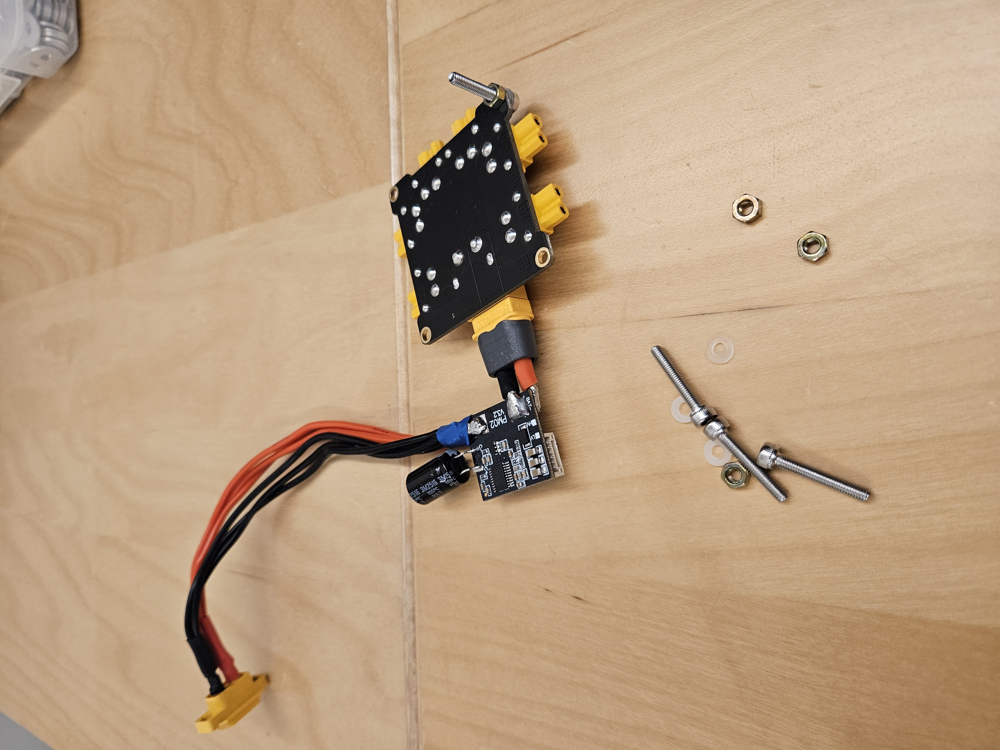
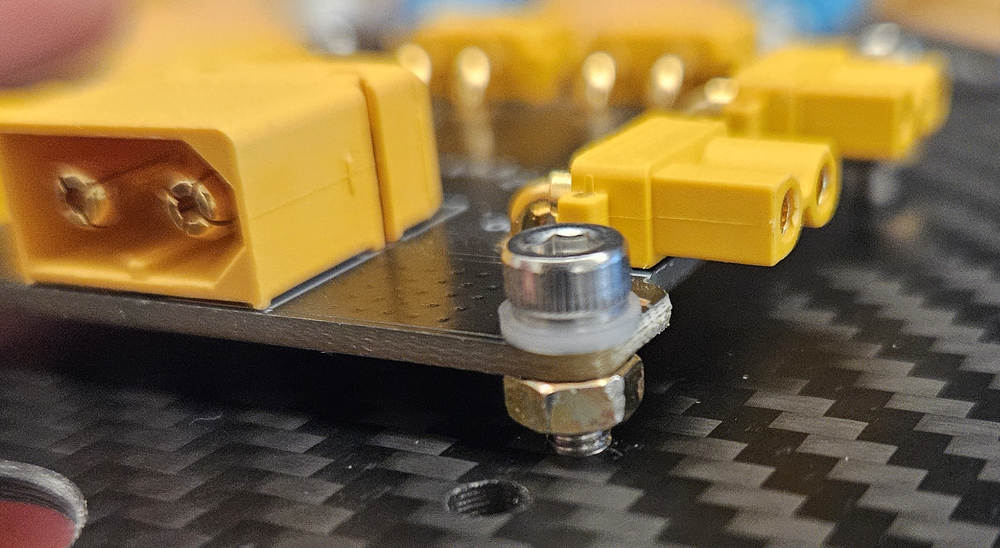
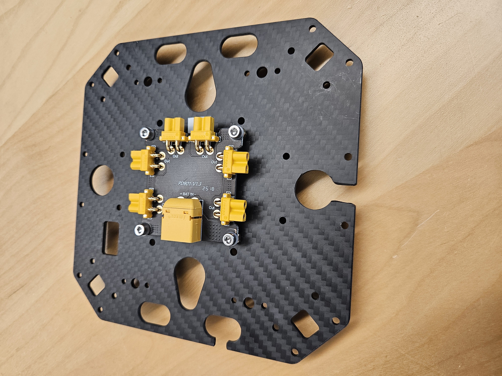
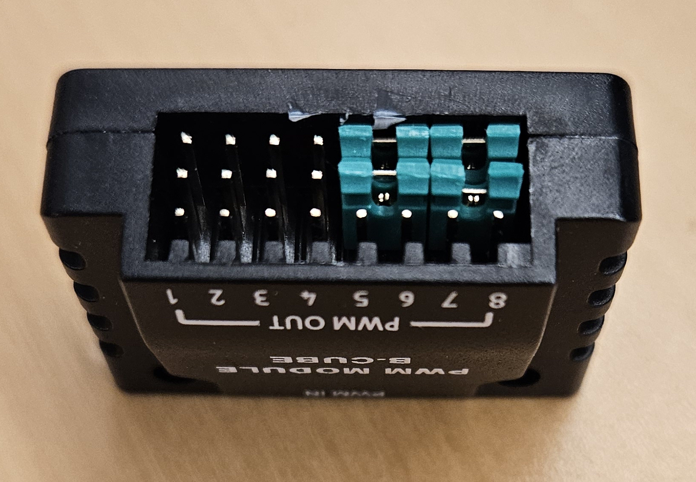
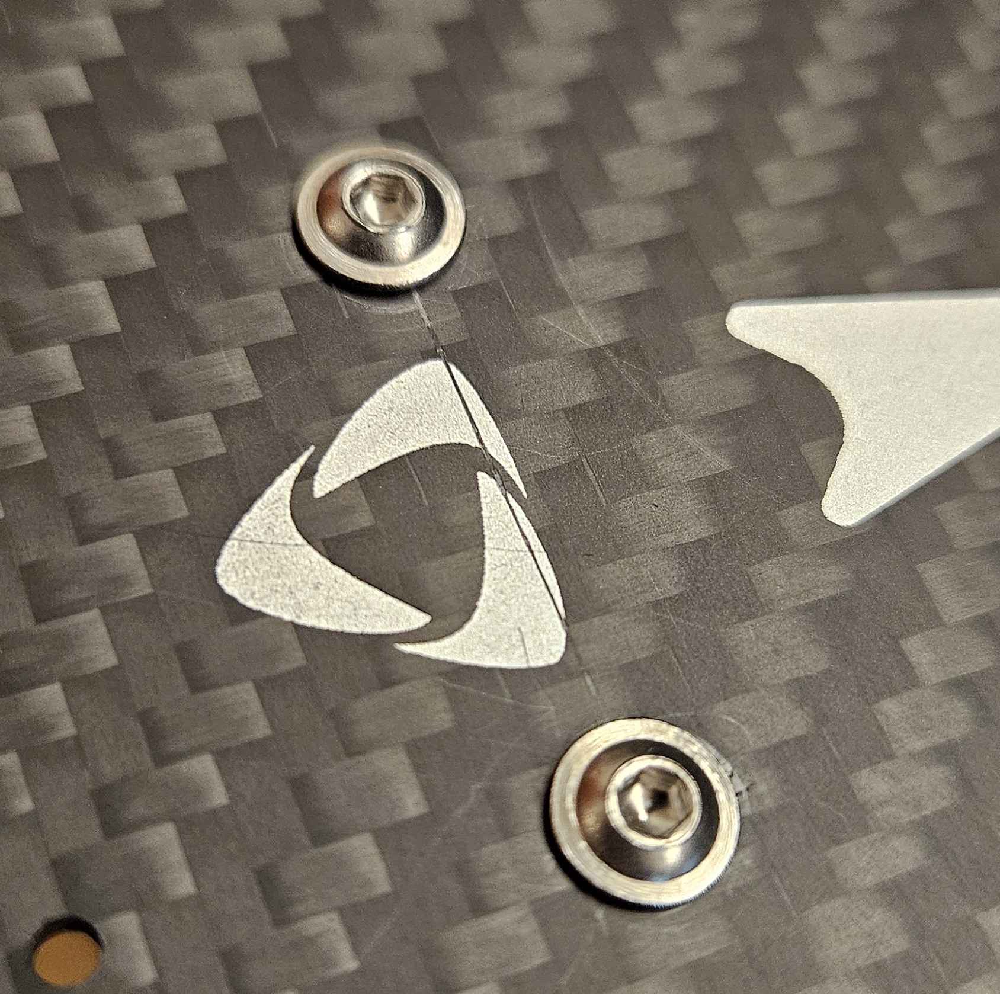
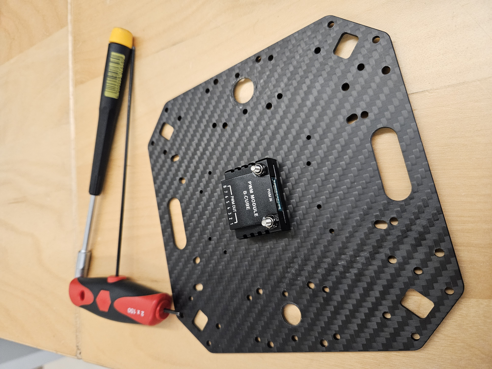
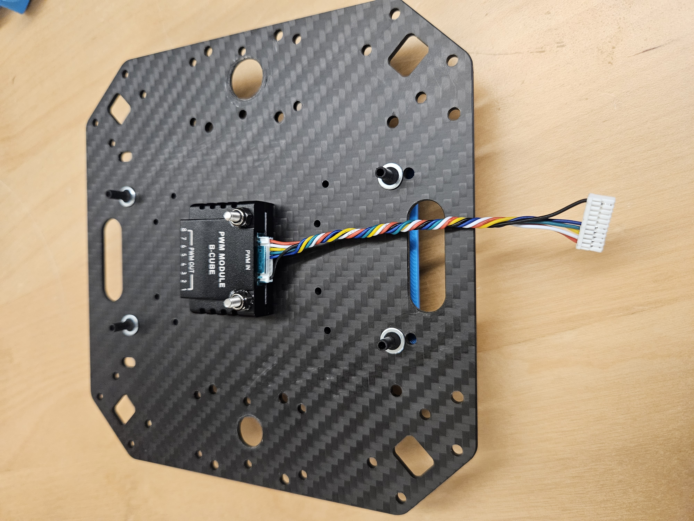
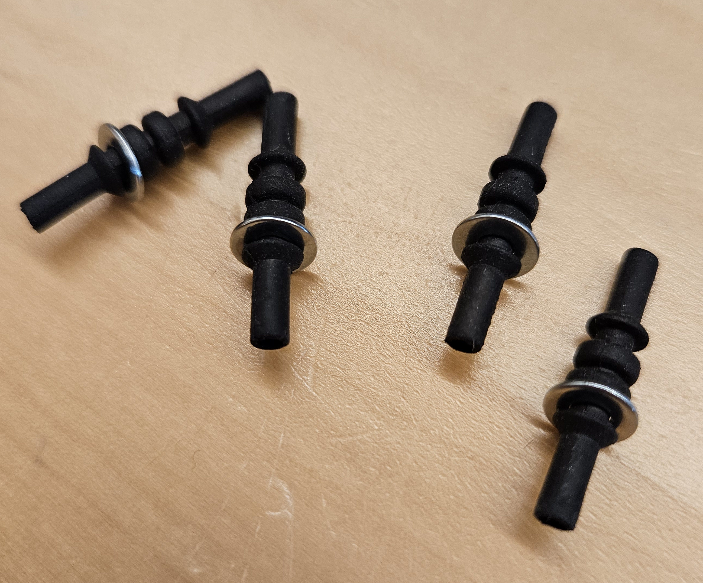
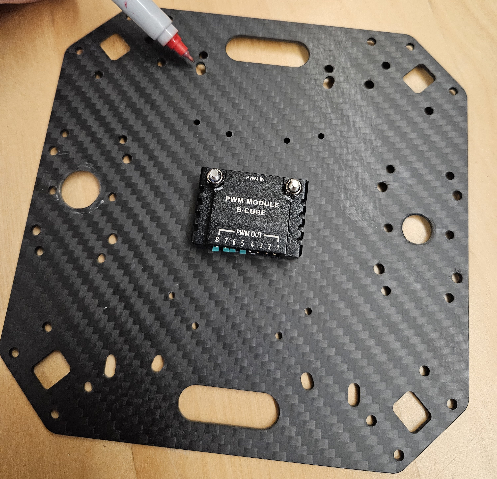

# X500 Assembly notes

## Conventions
- Screw heads are always facing UP toward the top of the aircraft
- With luck we'll have all hex, 2 and 2.5 mm fasteners. There may be a bunch of Torx on the electronics, but that's a different assembly procedure!

### Attach power distribution board to bottom plate

- Mount screws on the power distribution board
  - 4 x:
    - M3 X 18 socket head cap screw
    - M3 nut
    - M3 nylon washer
  - Put the nylon washer on the screw, pass it down through the top of the power distribution board, add the nut and tighten.

- pass the remainder of the length of the screws through the corresponding holes in the bottom plate.

### Prepare PWM Module B-Cube
- Place jumpers to block channels 5-8. Be sure to place them horizontally (across channels) so that they don't short anything!

- Screw the module onto the top of the top plate
  - 2x
    - M3 X 16 flange head socket screw
    - M3 Ny-lock
  - Drop the screws into the plate from the top

  - Place the module on the bottom of the top plate,  with the front (the place where the connector from the Pixhawk goes, should be Sharpied green and opposite the side with the jumper/blockers. Tighten the Ny-locks on with a 5.5 mm nut driver (turn the screw head with a hex key).

- Put the cable in it now; it's harder to access later!

### Mount the Flight Controller (PixHawk)
- The flight controller mounts on vibration dampers
  - 4 x
    - Rubber black tubular vibration dampers (as opposed to the bulbous ones) 
    - #4 flat steel washers
  - Pull the washers onto the dampers to the first detent.

  - Place the dampers in the slightly angled holes from the bottom

  - Pull them through until the washers seat

  - Place the flight controller plate onto the dampers. The arrow on the flight controller should point in the same direction as the arrow on the plate (in case that wasn't obvious). Pull the dampers through the holes until they seat (it'll be a snug pull as the holes in the plate are about the same size as the holes in the washers). 
    - Maybe make sure the SD card is in there.
  - Place the cable (10-pin, green side into the PWM module)
### Mount the safety switch button. Make sure the connector on the bottom is facing toward the back of the aircraft, as that's where the cable will be coming from. Insert the cable into the safety switch; it's harder to do once it's mounted.

### Put the top plate on the bottom plate, with the motor arms between them.
- Assemble each motor arm base
- Per arm:
  - 4x
    - M3 x 38 socket head cap screw
    - M3 flange Ny-lock nuts
- Match the motor number (on sticker, M1, M2, M3, M4) to the corresponding motor number on the top plate.
- Plug the control wire block into the PWM module now; it'll be much harder after the motor arms are in place!
- Assemble the two spar mount base pieces, with the collar facing out. Ensure the little round pins on the inside of them poke into the holes in the carbon fiber arrms, and that the rectangular tabs fit into the corresponding holes in the top and bottom plates. Push the M3 screw through the top plate, down through the spar mount base pieces, through the bottom plate, and add a Ny-Lock nut. Just add one screw per arm until you've got them all on, then add the remaining three per arm. Try to tighten them evenly; first snug them until the gaps are relatively even, then tighten them, ideally with a torque driver to about 7 pound-inches (or the equivalent non-insane metric unit). These do not need to be over-tightened as the spars are held in place by the pins in the holes in the spars, and the mounts are held in place by the rectangular tabs in the holes in the plates. 
- While you're at it, before you tighten everything up, check that the motors opposite one another will rotate in the same direction (3 wires parallel vs 2 of them crossed over)

- Make sure the arrow on the top plate is pointing in the same direction as the sticker arrow on the bottom plate! 
