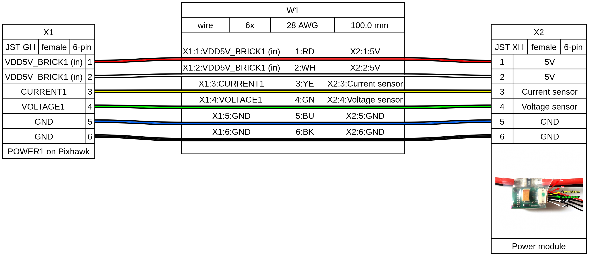
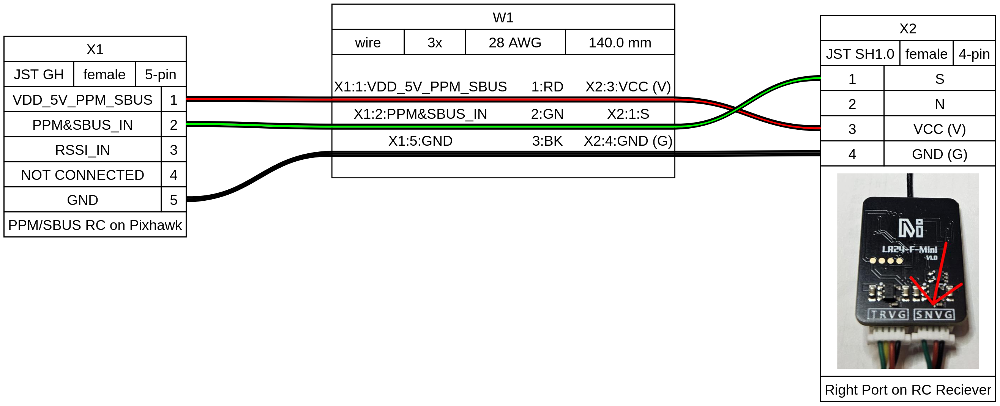
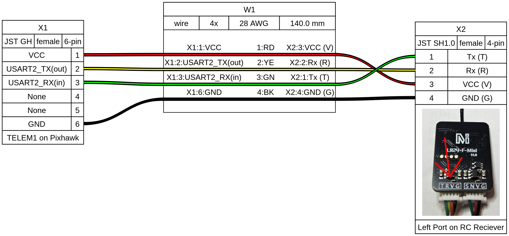
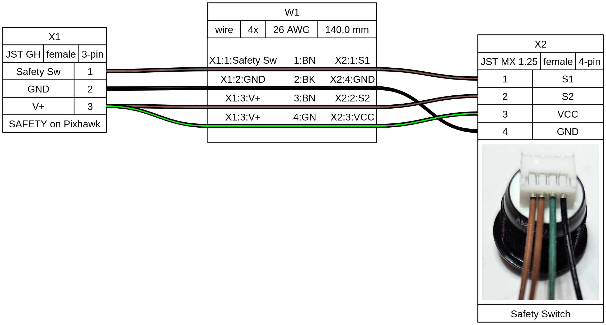
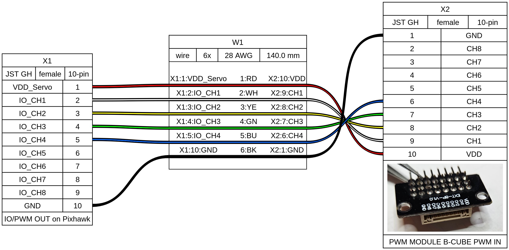
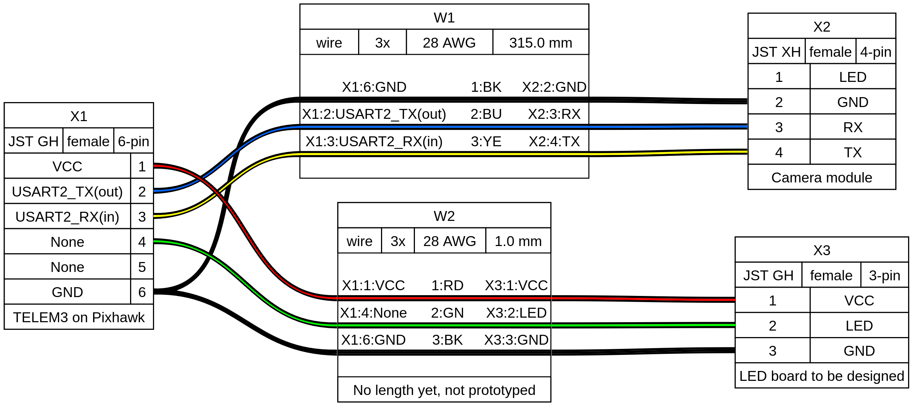

# Drone cables
This drone requires several specific cables for the flight controller to communicate with various components. Some of those cables can be purchased and used as-is, but some can't because they have unusual connector or pin configurations. Futhermore, it's preferable for the cables to be just long enough to reach their connecting components and no longer, to avoid messy fragile cable clutter. Therefore we're fabricating most of the cables with a crimper and cable connectors.

## Cable Diagrams

We're using [WireViz](https://github.com/wireviz/WireViz), a YAML protocol and renderer for describing cables and connectors.

This directory contains the raw YAML describing each of the connectors on the drone, as well as an SVG and PNG rendering of each.

It's possible to install WireViz locally, but as long as you have an Internet connetion it's probably easier to use an online converter. We're using [WireViz.app](https://www.wireviz.app/).

Lots of documentation on how to use it. For the most part the PNG/SVG renders should be sufficiently clear to fabricate and use the appropriate connectors with the appropriate lengths, colors, connector ends, and connections.

## Cables
### POWER on Pixhawk to the APM Power Module
The cable supplying power from the drone battery/power system to the flight controller is pretty straightforward and can be found for sale directly, assuming you can find the correct length. 

### Flight Controller to RC cables (2)
These are probably hard to find for sale unless it's part of a kit that includes the flight controller, RC receiver, and the cables between. Since we're using a flight controller and RC reciever that we purchased separately, and are using a setup with two separate communication channels (RC and Telemetry), we fabricated them.

The GH pins are quite fiddly to crimp (we succeeded by stripping exactly 2 mm from the end of each wire and crimping them with a general-purpose crimper, but it was tough (we literally did the stripping under a bench microscope). The SH pins are even worse. If you can find 15 cm GH to SH pre-crimped wires, definitely buy them and just poke them into the connectors (that's pretty easy)

#### PPM/SBUS RC on Pixhawk to the right socket on the RC receiver. 

#### TELEM1 on Pixhawk to the left socket on the RC receiver

SAFETY on Pixhawk to the Safety Switch
This one is a bear! One of the GH pins needs to have two wires crimped into the same pin, which is challenging to get right. Again, strip 2 (or maybe 2.5) mm of wire and try to get both into the same pin with some insulation in the back tabs and wire in the front. Good luck! We struggled but ultimately succeeded with some practice.

IO/PWM OUT on Pixhawk to PWM MODULE B-CUBE PWM IN
Be careful when plugging this one in; it's the only one that can be phyisically plugged in reversed. We Sharpied the end going into the PWM model green to make it as obvious as possible. 

### TELEM3 on Pixhawk to the Camera Subsystem
This one is weird because the TELEM3 port needs to feed both the custom camera module on the bottom of the drone, and the LED board showing status to the users on the top. TODO: not fully designed yet, waiting on the final camera and LED board designs. 

